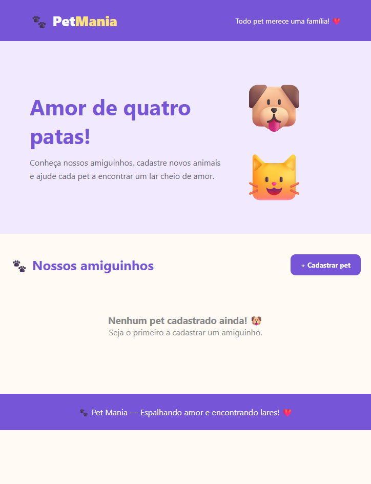
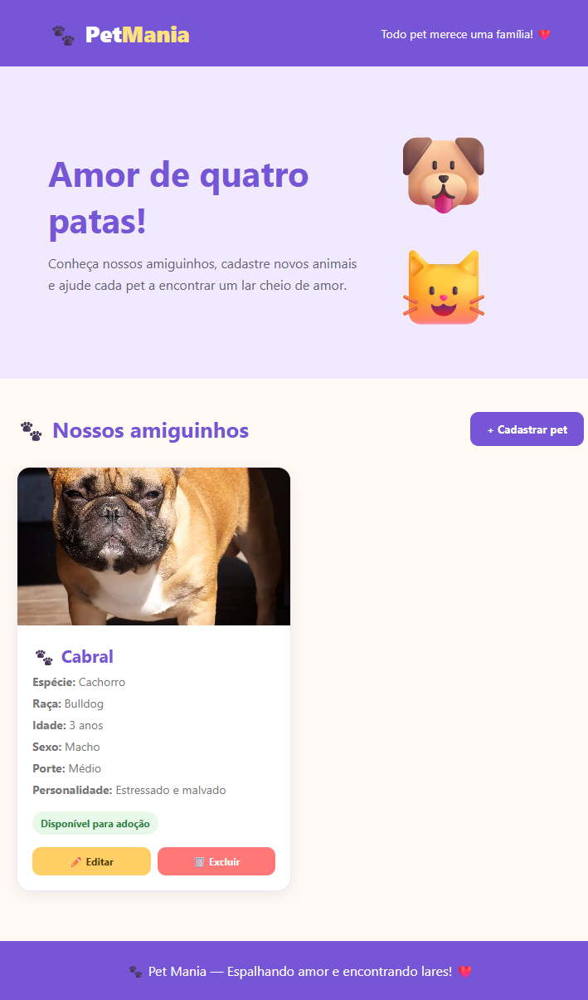
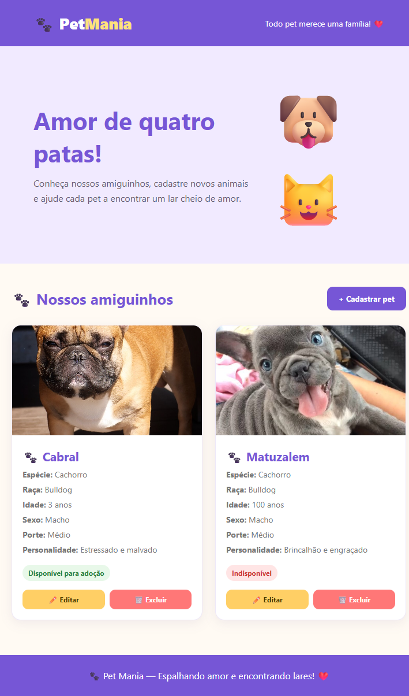
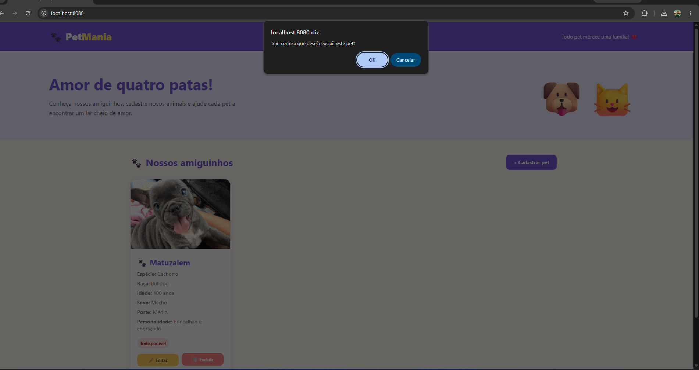
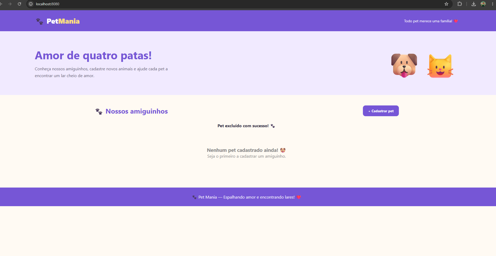
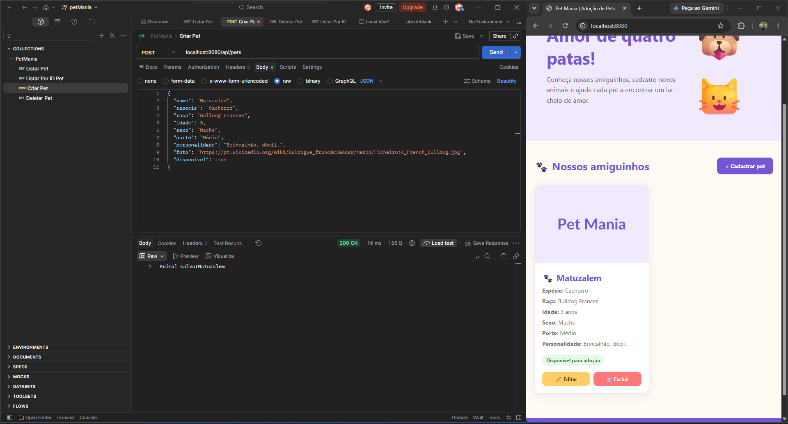
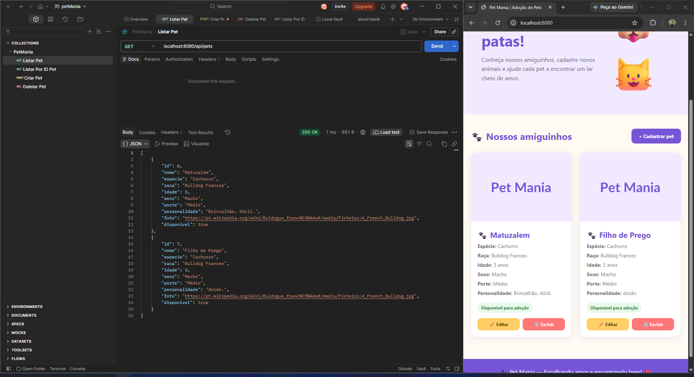
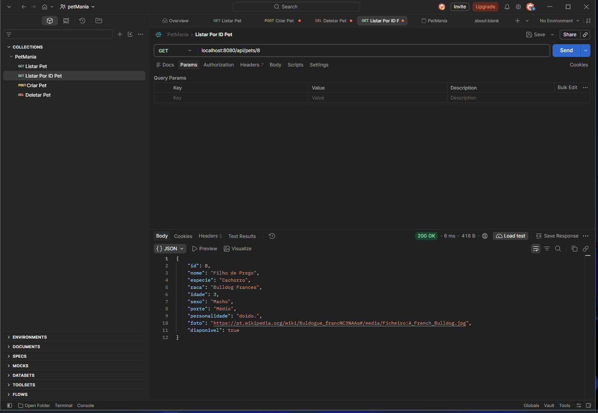
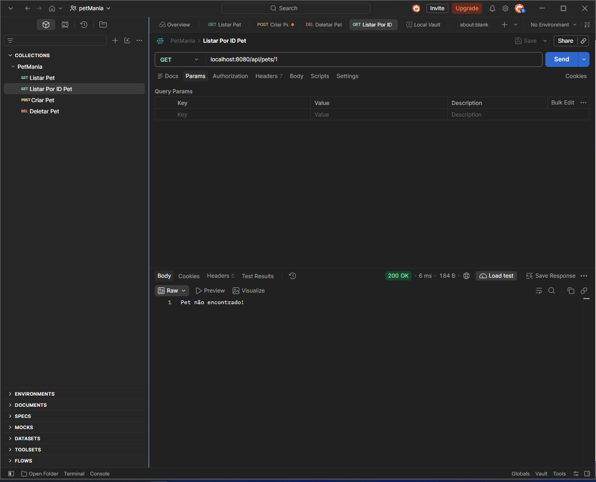

# PetMania — API REST e Plataforma de Adoção de Pets

O **PetMania** é uma aplicação desenvolvida em **Java com Spring Boot** e **MySQL** para o gerenciamento e divulgação de animais disponíveis para adoção.

---

## Este projeto é um desafio proposto pela professora Fiama Brenda (`FiamaBrenda/pet-mania-api-challenge`)

---
 
## Sobre o Desafio

A proposta da atividade consistiu em analisar um projeto Back-end em Java com problemas estruturais e de implementação, compreendendo a relação entre suas camadas para fazê-lo operar corretamente junto a uma interface web e validações via Postman:

- **Investigação e Correção:** Identificar erros de configuração, mapeamento JPA, tipagem e verbos HTTP nas camadas da aplicação.
- **Integração com Front-end:** Permitir o cadastro, a listagem e a exclusão de pets pela interface web disponibilizada.
- **Validação via Postman:** Testar e validar as requisições `GET` (todos os animais e por ID), `POST` (cadastro) e `DELETE` (exclusão).

---

## Ordem de Resolução e Boas Práticas Aplicadas

Para garantir que cada camada tivesse suas dependências resolvidas antes da próxima etapa, a refatoração seguiu o fluxo de construção da aplicação:

1. **Configuração de Dependências (`pom.xml`):** Inclusão dos starters Web (`spring-boot-starter-webmvc`) e JPA (`spring-boot-starter-data-jpa`), além dos módulos de teste específicos.
2. **Camada de Domínio (`Pet` e `Enums`):** Mapeamento objeto-relacional com `@Entity` e `@Table(name = "tb_pet")`, criação da chave primária auto-incrementável (`@Id` e `@GeneratedValue`), inclusão do construtor padrão vazio e padronização dos enums `Sexo` e `Porte`.
3. **Banco de Dados (`application.properties`):** Criação do schema `petmania` com suporte a caracteres especiais (`utf8mb4`) no MySQL e configuração das propriedades de conexão e do Hibernate (`ddl-auto=update`, `show-sql`, `format_sql`).
4. **Camada de Persistência (`PetRepository`):** Conversão da classe para `interface` estendendo `JpaRepository<Pet, Integer>`.
5. **Camada de Controle (`PetController`):** Correção das anotações Spring Web (`@RestController` e `@RequestMapping`), ajuste dos verbos HTTP (`GET`, `POST`, `DELETE`) e implementação da consulta individual (`GET /{id}`).

### Melhorias e Boas Práticas Implementadas Além do Escopo Básico
- **Uso de Classes Wrapper (`Integer` e `Boolean`):** Substituição de tipos primitivos na entidade `Pet` para evitar falhas de desserialização caso o formulário envie campos vazios (`null`) no payload JSON.
- **Tratamento de Exceções (`try-catch`):** Implementação de blocos `try-catch` nos métodos de criação (`POST`) e busca individual (`GET /{id}`) para tratar falhas de operação e registros inexistentes com mensagens claras.

**Histórico Técnico Detalhado:** Todas as comparações de código ("antes e depois") e justificativas técnicas de cada ajuste estão documentadas em [`docs/historico-alteracoes.md`](docs/historico-alteracoes.md).

---

## Tecnologias Utilizadas

- **Linguagem:** Java 21
- **Framework:** Spring Boot 4 (Spring Web MVC, Spring Data JPA)
- **Banco de Dados:** MySQL 8+
- **Gerenciador de Dependências:** Maven
- **Front-end:** HTML5, CSS3 e JavaScript (servido em `http://localhost:8080`)
- **Testes de API:** Postman

---

## Endpoints da API

A rota base da aplicação é `/api/pets`.

| Método | Endpoint | Descrição | Parâmetro / Corpo |
| :--- | :--- | :--- | :--- |
| `GET` | `/api/pets` | Lista todos os pets cadastrados | — |
| `GET` | `/api/pets/{id}` | Busca um pet específico pelo ID | `id` (Path Variable) |
| `POST` | `/api/pets` | Cadastra um novo pet no banco de dados | JSON no corpo da requisição |
| `DELETE` | `/api/pets/{id}` | Remove um pet pelo ID | `id` (Path Variable) |

### Exemplo de Payload (`POST /api/pets`)

```json
{
  "nome": "Matuzalem",
  "especie": "Cachorro",
  "raca": "Bulldog Francês",
  "idade": 3,
  "sexo": "Macho",
  "porte": "Médio",
  "personalidade": "Brincalhão, dócil.",
  "foto": "https://exemplo.com",
  "disponivel": true
}
```

---

## Evidências de Funcionamento

### Interface Web (Front-end)

**Tela Inicial (Sem Pets Cadastrados)**



**Listagem de Pets Cadastrados**



**Formulário de Cadastro de Novo Pet**



**Confirmação e Feedback de Exclusão**





---

### Testes de Endpoints no Postman

**Cadastro de Pet (`POST /api/pets`)**



**Listagem Geral (`GET /api/pets`)**



**Busca Individual por ID (`GET /api/pets/{id}`)**



**Exclusão por ID (`DELETE /api/pets/{id}`)**



---

## Como Executar o Projeto Localmente

### Pré-requisitos

- **JDK 21** instalado
- **MySQL** em execução na porta `3306`
- **Maven** (ou uso do wrapper `./mvnw` incluído no repositório)

### Passo a passo

1. **Clone este repositório:**
   ```bash
   git clone https://github.com/Victor-Suander/pet-mania-api-challenge.git
   cd pet-mania-api-challenge
   ```

2. **Crie o banco de dados no MySQL:**
   ```sql
   CREATE DATABASE IF NOT EXISTS petmania
   CHARACTER SET utf8mb4
   COLLATE utf8mb4_unicode_ci;
   ```

3. **Configure as credenciais do banco:**
   Abra o arquivo `src/main/resources/application.properties` e ajuste `spring.datasource.username` e `spring.datasource.password` conforme o seu usuário e senha do MySQL local.

4. **Inicie a aplicação:**
   ```bash
   ./mvnw spring-boot:run
   ```

5. **Acesse a aplicação:**
   - **Interface Web:** `http://localhost:8080`
   - **API REST:** `http://localhost:8080/api/pets`
